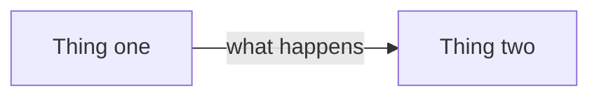

<!-- page details (read by the checker; hidden when reading)
id: page-id-same-as-file-name
title: Page title in plain words
layer: build | component | troubleshooting | glossary | why | meta
type: explanation | reference | how-to | tutorial
status: draft
covers: [path/to/the/file/it/describes]
verified_on: null
verified_by: null
sources: [stage0-command-log.md#NNN, path/to/paper.md]
-->

# Page title

## In plain words
Three to five sentences, no jargon. Link every new word to the glossary: [[glossary-word]].

## Picture

## If this breaks
- **You notice:** ...
- **First safe step:** ... (reads only; changes nothing)
- **Read next:** [[page]]

## How it connects
- depends_on [[page]]
- protects [[page]]
- built_in [[page]]
- why [[page]]
- replaced_by [[page]]

## Technical facts
- Fact (DOC, log #NNN).

## History (not current instructions)
- What we tried, what happened, why we changed it (log #NNN).

## Not verified
- What nobody has checked yet.
