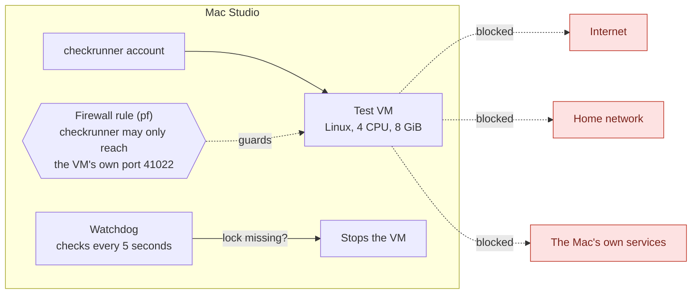

<!-- page details (read by the checker; hidden when reading)
id: c8-test-vm
title: "C8: the sealed test VM"
layer: build
type: explanation
status: draft
covers: [c8/common.sh, c8/lui3-vm.pf, c8/lu.spacedog.lui3.pf-vm.plist, c8/override.yaml, c8/setup.sh, c8/vm-boot.sh, c8/lu.spacedog.lui3.vm.plist, c8/check.sh, c8/boot-drills.sh, lui3-part-c-c8-test-vm-2026-11-20.md]
verified_on: null
verified_by: null
sources: [lui3-part-c-c8-test-vm-2026-11-20.md, lui3-stage-0-progress.md, stage0-command-log.md#115-#147]
-->

# C8: the sealed test VM

## In plain words
The builder's code has to be tested somewhere it can do no harm. C8 built a small Linux computer that lives inside the Mac Studio, a [[test-vm]] (run by the [[colima-lima]] tools), owned by the [[checkrunner]] account. It can reach nothing outside itself: no internet, no home network, not even the Mac's own services. A [[pf]] firewall rule enforces that, and a [[watchdog]] stops the VM within seconds if the lock is ever missing. It starts by itself when the Studio boots, with no one signed in to the checkrunner account (no screen sign-in needed; log #147).

## Picture

## If this breaks
- **You notice:** checks cannot run, or the watchdog log says it stopped the VM.
- **First safe step:** read the watchdog log on the Studio, `/var/log/lui3-vm.log` (needs `sudo`: STOP label, but it only reads). It names the reason. Never start the VM by hand with `colima start`.
- **Read next:** [[test-vm-will-not-start]].

## How it connects
- depends_on [[pf]]
- depends_on [[checkrunner]]
- depends_on [[watchdog]]
- protects [[builder]]
- related [[c7-locked-paths]]
- part_of [[index]]

## Technical facts
- Tools: Colima 0.10.3, Lima 2.3.0, Apple Virtualization (VZ); VM owned by `checkrunner`, 4 CPU, 8 GiB, no shared folders (DOC, progress file, C8 block).
- The lock has four parts (DOC, progress file "How the C8 lock works"):
  1. pf anchor `com.apple/lui3-vm`, loaded at boot by `lu.spacedog.lui3.pf-vm`: checkrunner sends no TCP or UDP except to its VM's ssh port 41022 on loopback; outgoing pings are dropped Mac-wide (decision R1; written #135, refined #136, loaded #137).
  2. `override.yaml` v4 (the override file has its own version numbers, separate from the lock versions under History): ssh port 41022, Lima's host name service off, no VM port forwarded, Lima's boot-time package install skipped (#125, #127, #145).
  3. Colima starts with `GODEBUG=netdns=go+1`, so name lookups are checkrunner's own packets, which the lock drops (#134).
  4. Startup job and watchdog `lu.spacedog.lui3.vm` (root, `/Library/Lui3/c8/vm-boot.sh`): checks its files and the pinned VM settings, waits for the lock, starts the VM; every 5 s stops it if the lock is gone (#139 to #147).
- Last results (DOC): green 79/0/0, red 64/0 (#146); after a real restart the job started the VM in 16 s and `check.sh boot` passed 83/0/0 (#147); watchdog drills 8/0.
- Run order and undo: see the progress file, "How the C8 lock works" (facts live once). Undo scripts are deleting class: STOP.

## History (not current instructions)
- v1 got stuck at a second failure on the same step (#118); research (#119) led to v2, a lock by user account (#122, #123).
- Facts runs found that Lima still forwarded the VM's own [[loopback]] ports and looked up names for it (#125, #127); v3 then switched off forwarding and host name lookups (#128, #129).
- v4 forced Go's own name resolver so lookups could be blocked (#132 to #134); v5 added the Mac-wide ping block (#135 to #137).
- Restarts from the startup job hung at "boot scripts" (#141): the cause was Lima running `apt-get update` inside the VM, which the lock blocked, not launchd (#142 to #145). Fixed by skipping Lima's package install (#145); a real reboot then passed (#147).

## Not verified
- Whether another account could read the VM's pings to the Mac's own address (loopback left open on purpose).
- Whether the 8 GiB VM fits next to the local model (record row 16.1 test 3).
- A sandbox around the VM start (R1 part 2) is a later trial.
