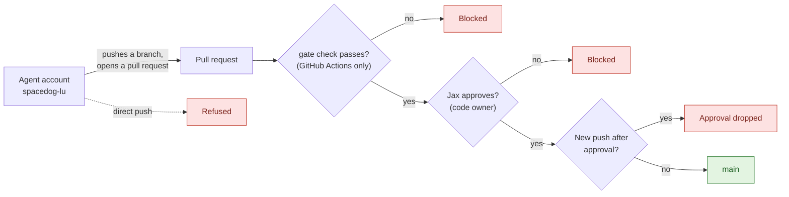

<!-- page details (read by the checker; hidden when reading)
id: part-b-github-locks
title: "Part B: GitHub locks against the agent"
layer: build
type: explanation
status: draft
covers: [lui3-stage-0-part-b-check-2026-11-17.md, lui3-part-b-click-steps-2026-11-17.md, drills/run-part-b-drills.sh, drills/run-part-b-attacker-drills.sh]
verified_on: null
verified_by: null
sources: [lui3-stage-0-part-b-check-2026-11-17.md, lui3-part-b-research-2026-11-17.md, stage0-command-log.md#43-#60]
-->

# Part B: GitHub locks against the agent

## In plain words
The AI agent writes code and sends it to GitHub, but it must never be able to put code into the real project on its own. Part B set GitHub's own locks so that the only way code reaches the protected [[main-branch]] is a [[pull-request]] that passes the automatic check (`gate`) **and** gets Jax's approval. Every lock was tested by trying to break it, first with scripts and then by a helper whose only job was to find a way around. Every lock held. One advisory check (the size budget for pull requests) can be skipped by the agent; that was accepted for Stage 0 (log #57). Jax signed Part B off on 2026-11-17.

## Picture

## If this breaks
- **You notice:** a change appears on `main` that you never approved, or a pull request can be merged without your review.
- **First safe step:** do not merge anything. Open the repo's **Settings > Branches** page (the classic branch protection rule for `main`) and compare it with Screen 3 of `lui3-part-b-click-steps-2026-11-17.md`. Looking changes nothing.
- **Read next:** the drills in `drills/run-part-b-drills.sh` re-test every lock (Jax runs them; they need the agent's token, so they are a planned step, not a quick check).

## How it connects
- protects [[main-branch]]
- depends_on [[pull-request]]
- part_of [[index]]
- related [[c7-locked-paths]]

## For agents: technical details
*Everything from here down is for agents and for checking facts. You can stop reading here.*

### Exact details (for agents)
| What | Value | Source |
|---|---|---|
| Runs on | GitHub, repos `moon-hound/lui3` (real) and `moon-hound/lui3-scratch` (drills); both private, plan GitHub Pro | Part A check O1, #47 |
| Accounts | owner `moon-hound` (Jax); agent `spacedog-lu` (collaborator; its token: classic, scope `repo`, reaches 2 repos, no `workflow` scope, **expires 2026-11-25 05:32 UTC**: any drill run after that needs a new token) | #51, #56 |
| Rule on `main` | classic branch protection rule, id 86016372: pull request required, 1 approval, stale approvals dismissed, code owner review, approval of the most recent push, branches up to date, required check `gate` pinned to GitHub Actions (app 15368), no bypassing, force pushes and deletions off, no direct push. The scratch repo's rule id was not recorded | #47, #48, click steps Screen 3 |
| Required check | job `gate` (in `ci.yml` on `lui3`; workflow display name NOT CHECKED) | #47, progress file |
| Health check | `drills/run-part-b-drills.sh` and `drills/run-part-b-attacker-drills.sh`, run by Jax on the laptop with the agent's token (a planned step, no `sudo`). Run in `scratch` mode first; `lui3` mode opens and closes drill pull requests on the real repo | Part B check, #57 |
| Undo | change the rule back on **Settings > Branches** (Jax, by hand) | click steps |

### Technical facts

- Locks proven, each by a drill that was refused (DOC, Jax's pasted output):
  - a fake `gate` result is ignored, because the check's source is pinned to GitHub Actions (B1, log #56);
  - no direct push to `main` (B2, error GH006, #56);
  - the agent cannot approve its own pull request (B3, #56, #57);
  - the agent cannot push workflow files: its token has no `workflow` scope (B4, #52, #56);
  - no merge without the owner's review (B5, #56, #57);
  - changing the code-owner file inside its own pull request does not help (B6, #56, #57);
  - the agent cannot read or change the branch rule or the Actions settings (B7: 404, 404, 403; #52, #56);
  - the agent's token has scope exactly `repo`, an expiry, and reaches only 2 repos (B8, #51, #56, #57).
- Drill totals (DOC): scratch repo 14 passed / 0 failed (#56); real `lui3` repo 9 passed / 1 failed, the one failure being the skippable size budget (#57).
- Live attacker drills, 5 passed, 0 failed (DOC, log #60): new code pushed after Jax approved drops the approval (A1); changing the pull request's target to `main` after approval also drops it (A2); webhooks and deploy keys are out of reach (A3, 404).
- Red then green: before the scratch rule was complete, a direct push got through (#52); the completed rule refused it (#56) (MINE: this is the "weakened copy fails" proof).
- Rule on `lui3`: classic branch protection rule, id 86016372, read back as saved (#47, #48).

### Accepted exceptions (Part B check, section 4; Jax accepted them at sign-off)
1. The locks cannot make a reviewer understand what a pull request really does; the reviewer helpers must flag risky changes in plain words (build phase).
2. The agent can skip the advisory size budget (#57); build-phase fix planned. Details: Part B check, section 4.
3. The "require actions pinned to a full commit SHA" box would not stay ticked (#48); the actions are pinned in the files instead.
4. Two-factor on the accounts: parked by Jax.
5. Tags are unprotected; nothing runs on tags, and it must stay that way.
6. Leftover drill branches and pull requests are removed at the end-of-Stage-0 cleanup.
7. A second, short-lived agent token was made for the live drills (#60); its deletion is NOT CHECKED.

### History (not current instructions)
- The first scratch rule was incomplete and let a direct push through (#52); fixed before sign-off.
