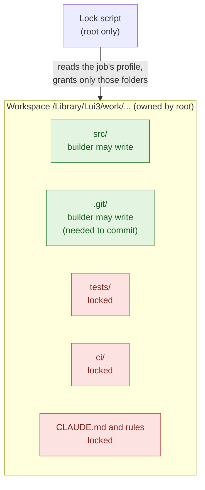

<!-- page details (read by the checker; hidden when reading)
id: c7-locked-paths
title: "C7: locked paths on the Mac Studio"
layer: build
type: explanation
status: draft
covers: []
covers_hash: null
verified_on: null
verified_by: null
sources: [lui3-part-c-c7-locked-paths-2026-11-19.md, lui3-stage-0-progress.md, stage0-command-log.md#112, stage0-command-log.md#113]
-->

# C7: locked paths on the Mac Studio

## In plain words
The [[builder]] account writes code on the Mac Studio, but some files must be off-limits to it: the rules it follows, the tests that judge its work, and the scripts that check it. C7 makes every workspace owned by the administrator (root) and gives the builder write access only to the folders its current job needs, using [[acl]] permissions. Anything not handed out is locked by default. The test: on a stand-in workspace, the builder tried to change 15 locked files and 13 locked folders in every way the drills tried, and every try failed (log #113). One low-level Git route around the lock is known and accepted (record row 17.7).

## Picture

## If this breaks
- **You notice:** the builder changed a test, a rule file or a check script.
- **First safe step:** stop the builder's session. Do not run anything inside the builder's workspace as root (rule under Technical facts).
- **Read next:** `lui3-part-c-c7-locked-paths-2026-11-19.md`; then re-run the checks on the Studio with `sudo sh check.sh` in green mode only, never `red` (STOP label: `sudo`; it creates and removes files in the stand-in workspace, and red mode weakens a lock on purpose).

## How it connects
- protects [[builder]]
- part_of [[index]]
- related [[part-b-github-locks]]
- related [[c8-test-vm]]

## For agents: technical details
*Everything from here down is for agents and for checking facts. You can stop reading here.*

### Exact details (for agents)
| What | Value | Source |
|---|---|---|
| Runs on | Mac Studio `lui-mac.local` (192.168.1.101) | host name: log #1 to #3; address: `CLAUDE.md` |
| Accounts | `builder` (UID 502, no admin) writes; root owns every workspace | log #88, #113 |
| Workspaces | `/Library/Lui3/work/<name>/` (root-owned); stand-in `/Library/Lui3/work/c7-standin` | #113 |
| Lock script | `/Library/Lui3/bin/lui3-lock-workspace <name> <profile>` (root only); profiles in `/Library/Lui3/profiles/` (`drill.txt` today) | `c7/install.sh`, #113 |
| Install record | `/var/db/lui3-c7-installed.txt`; installed fingerprints (sha256) lock script `3999da0c…`, profile `6a37e39a…` (full values in log #113), to spot tampering | #113 |
| Git trap | Git refuses the root-owned workspace unless it is given `safe.directory` for it; the launcher passes it, nothing else should | #113 |
| Health check | on the Studio as `lui`, from `~/lui3-stage0/c7`: `sudo sh check.sh` (green; good = 0 FAIL, last 81/0). STOP label: `sudo`. Never `red` outside a planned drill | #113 |
| Undo | on the Studio: `sudo sh ~/lui3-stage0/c7/uninstall.sh` (STOP: `sudo`, deleting) | progress file |

### Technical facts

- Workspaces are root-owned under `/Library/Lui3/work`; the builder writes only in its profile's folders (in the drill profile: `src/` and `.git/`) through ACLs, so every locked path of record row 17.2 is locked by default (DOC, log #112, #113).
- Lock script `/Library/Lui3/bin/lui3-lock-workspace` and `profiles/drill.txt` are root-owned; install record `/var/db/lui3-c7-installed.txt` (DOC, #113).
- Drills on the stand-in: 15 locked files and 13 locked folders could not be written, touched, re-permissioned, given a new ACL or flag, renamed, deleted or added to; the builder's own work and Git commits still worked. Red run 75 pass / 6 fail, then green 81 / 0 (DOC, #112, #113).
- **Standing rule (current): no privileged tool ever changes owner, rights or flags inside a builder-writable folder**, because the builder can plant links there (DOC, #113).
- Rule from C7.1b: nothing privileged reads from `/Users/Shared` or `/tmp` (MINE, from the shared-places check, #113).
- [[snapshot]] before the run: `2026-11-19-175145`. Undo: `c7/uninstall.sh` (deleting class: STOP).

### History (not current instructions)
- The C7 run (#113) showed the builder could plant links to root-owned files inside its writable folder (#113); that finding produced the standing rule above.

### Not verified
- Whether the builder can add a *new* ACL right to a root-owned file in a granted folder (expected no; a later drill, C13).
- The real profiles (interview, test writer, build, proof writer) are written in C10.
