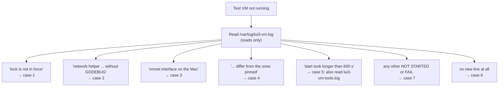

<!-- page details (read by the checker; hidden when reading)
id: test-vm-will-not-start
title: The test VM will not start
layer: troubleshooting
type: how-to
status: draft
covers: [c8/vm-boot.sh, c8/boot-install.sh, c8/boot-uninstall.sh, c8/check.sh]
verified_on: null
verified_by: null
sources: [c8/vm-boot.sh, stage0-command-log.md#136, stage0-command-log.md#141-#147, lui3-stage-0-progress.md]
-->

# The test VM will not start

## In plain words
The [[test-vm]] is started and watched by a [[watchdog]]. When the VM is not running, the watchdog almost always wrote down why, and the reason is usually a safety check doing its job. Read the logs first and change nothing until you know which case you are in.

## Picture

## If this breaks
- **First safe step (always):** on the Studio, as `lui`, read the last lines of the watchdog log: `sudo tail -n 40 /var/log/lui3-vm.log`. **STOP label: it needs `sudo` (your password), but it only reads.** Jax types it.
- **Never:** start the VM by hand with `colima start`, run Lima as root, or run `check.sh red` (red mode lifts the lock on purpose for about 150 s; the watchdog tolerates that for at most 160 s; log #136, `c8/common.sh`).

| Case | The watchdog log says (DOC, `c8/vm-boot.sh`) | What it means | Safe next step |
|---|---|---|---|
| 1 | "the VM lock is not in force;" (watchdog stopped a running VM) or "NOT STARTED: after 180 s the lock is still not in force" (at start) | the [[pf]] rule is missing, so the watchdog stopped the VM on purpose | find out why the firewall rule is missing (for example after a macOS update); check with `sudo sh check.sh` (green mode only, never `red`; STOP label: `sudo`) |
| 2 | a network helper runs without GODEBUG | the VM's name lookups could escape the lock | ask the panel; do not restart until the cause is known |
| 3 | "vmnet interface on the Mac (...)" | a network path the lock cannot see exists | ask the panel; do not restart until it is gone |
| 4 | "Lima's _config files differ ..." or "colima.yaml's values differ from the ones pinned at install" | a VM setting changed since install; the job refuses to start | compare before re-pinning; re-pin only through `boot-uninstall.sh` then `boot-install.sh` (both STOP) |
| 5 | "the start took longer than 600 s;" or "the start check failed;" | the VM began starting but did not finish; Colima's own output is in `/var/log/lui3-vm-tools.log` | read that file too (`sudo tail -n 40 /var/log/lui3-vm-tools.log`, STOP label, reads only); the known cause (the VM waiting for the internet at "( 5/5) Boot scripts to be finished") is already switched off, see [[c8-test-vm]] History |
| 6 | no new line at all | the job itself is not running | ask the panel to check the job's state read-only |
| 7 | any other "NOT STARTED" or "FAIL" line (for example a port already in use, another Colima command running, a changed firewall file) | one of the job's other start checks refused | ask the panel; do not restart until the cause is known |

- **After the cause is fixed:** the log itself prints the restart command: `sudo launchctl kickstart -k system/lu.spacedog.lui3.vm` (DOC, `c8/vm-boot.sh`). **STOP label: `sudo` and launchd.**

## How it connects
- depends_on [[c8-test-vm]]
- depends_on [[watchdog]]
- part_of [[index]]

## For agents: technical details
*Everything from here down is for agents and for checking facts. You can stop reading here.*

### Exact details (for agents)
| What | Value | Source |
|---|---|---|
| Runs on | Mac Studio `lui-mac.local` (192.168.1.101), as `lui` | log #1 to #3, `CLAUDE.md` |
| Logs | watchdog `/var/log/lui3-vm.log`; Colima and tools `/var/log/lui3-vm-tools.log`; firewall job `/var/log/lui3-pf-vm.log` | `c8/vm-boot.sh`, `c8/common.sh` |
| Read a log | `sudo tail -n 40 <log>` (STOP: `sudo`; reads only) | |
| Health check | from `~/lui3-stage0/c8`: `sudo sh check.sh` (green only; STOP: `sudo`) | #146 |
| Restart after the fix | `sudo launchctl kickstart -k system/lu.spacedog.lui3.vm` (STOP: `sudo`, launchd) | `c8/vm-boot.sh` |
| Never | `colima start` by hand; Lima as root; `check.sh red` outside a planned drill | progress file, #136 |

### Technical facts
- The watchdog log is `/var/log/lui3-vm.log`; Colima's output and tool errors go to `/var/log/lui3-vm-tools.log`, never into the watchdog log (DOC, `c8/vm-boot.sh` header).
- Case 4 happened on 2026-11-21: Colima rewrites `colima.yaml` at every start, so it is now pinned by its values, not its fingerprint (DOC, log #141, #142, #145).
- The cause behind case 5 happened on 2026-11-21 (the 600 s message itself never fired: drill W2 stopped the VM after about 4 minutes, #141): Lima's boot script ran `apt-get update`, which the lock blocks; fixed with `skipDefaultDependencyResolution` (DOC, #144, #145).
- After any change to `common.sh`, `vm-boot.sh`, `override.yaml` or the startup plist: `boot-uninstall.sh` then `boot-install.sh` (progress file, C8 run order).

### History (not current instructions)
- Cases 4 and 5 were found during the first restarts from the startup job (#141 to #145). The old wording of case 4 was "the VM's settings files differ from the ones pinned at install" (#141); the script now names the file.

### Not verified
- Cases 2, 3, 6 and 7 have never happened outside drills; the steps for them are a plan, not a tested routine.
- Whether reading `/var/log/lui3-vm.log` really needs `sudo` (NOT CHECKED; `sudo` is the safe assumption).
